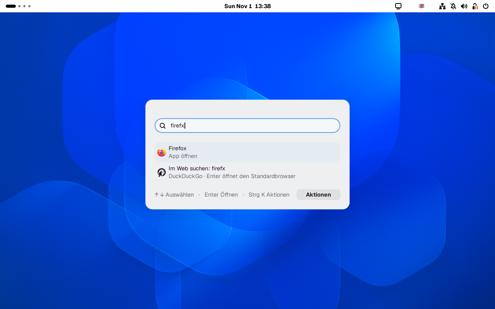

# LightOS

A GNOME Shell extension for GNOME 50 / Wayland.



## Features

- Native GNOME top bar, StatusNotifier tray and compact system menu; optional **42 px** panel height.
- Compact search at 70% scale with **Super + Space**: apps, windows, files, calculations, favorites and aliases, without desktop dimming.
- Five palettes, wallpaper colors via ChromaLeon, supported app colors and automatic light/dark switching.
- System monitoring, app updates, cache cleanup and offline OCR.
- Geist / Adwaita font selection, window centering and optional workspace and interaction controls.

## Installation

```bash
python3 tools/build.py
gnome-extensions install --force dist/lightos@lightos.dev.shell-extension.zip
```

Log out and back in under Wayland, then enable LightOS:

```bash
gnome-extensions enable lightos@lightos.dev
```

[Usage and requirements](docs/guide.md) · [Sources and licenses](THIRD_PARTY.md) · [GPL-3.0](LICENSE)
