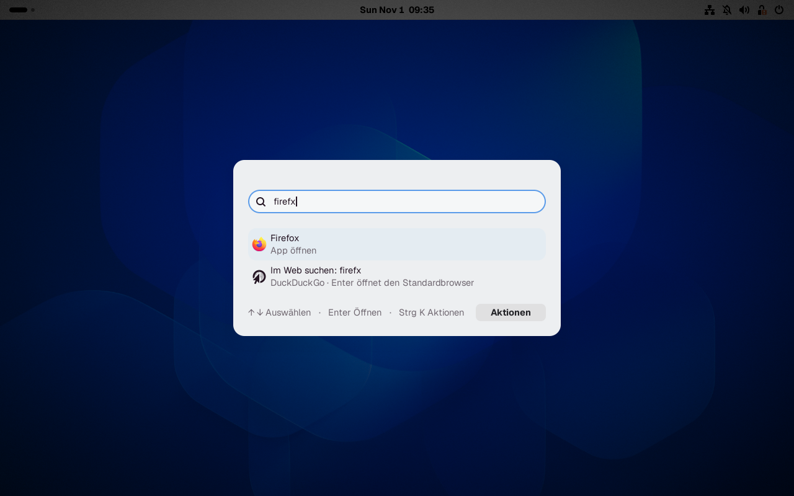

# LightOS

A GNOME Shell extension for GNOME 50 / Wayland.

## Features

- Native GNOME top bar with optional **42 px** height; no additional menus or Activities replacement.
- Light palettes also apply to Quick Settings and calendar, with a white top bar and black text.
- StatusNotifier tray for running applications.
- Compact, titleless search with **Super + Space**: equal-width input and results, adaptive ranking, favorites, aliases, GNOME commands, apps, windows, files and calculations.
- Five color palettes and ChromaLeon colors from your wallpaper, also applied to supported apps.
- Automatic light/dark switching at sunrise and sunset.
- Geist and Geist Mono by default, with an Adwaita / Geist selector and reversible font settings.
- Window centering with **Ctrl + Super + C**, optional font smoothing, and press feedback animations.

## Sources

- [Oma Cast](https://github.com/typecraft-dev/oma-cast) – interaction reference for the native GJS launcher; [integration and license boundary](docs/oma-cast.md).
- [Findus](https://github.com/Garlus/findus) – window centering, font smoothing, and press feedback animations.
- [ChromaLeon](https://github.com/Fabito02/ChromaLeon) – wallpaper colors and color engine.
- [t3code](https://github.com/pingdotgg/t3code) – color palettes.
- [Geist](https://github.com/vercel/geist-font) – bundled sans and monospace fonts, SIL OFL 1.1.
- [Night Theme Switcher](https://gitlab.com/rmnvgr/nightthemeswitcher-gnome-shell-extension) – sunrise and sunset calculations.

[Installation and usage](docs/guide.md) · [Attribution and licenses](THIRD_PARTY.md) · [GPL-3.0](LICENSE)

[Search controls and integration](docs/oma-cast.md) · [Theme installation assessment](docs/theme-installation-evaluation.md)

Panel height: [Preferences → LightOS → Top Bar mit 42 px](docs/screenshots/gnome/panel-height-preferences.png). Disabled by default; switching it off or disabling LightOS restores the native height.

[Layout and Shell validation](docs/shell-layout-validation.json) · [Light Quick Settings](docs/screenshots/gnome/panel-42-light.png) · [Light calendar](docs/screenshots/gnome/light-ocean-calendar.png)
