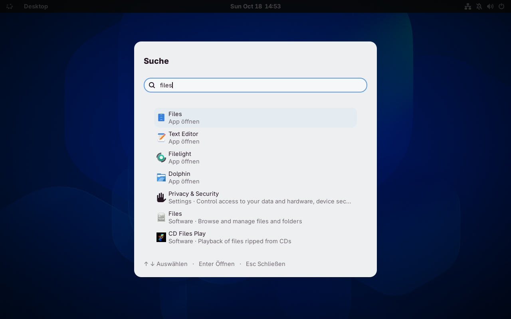

# LightOS

A GNOME Shell extension for GNOME 50 / Wayland.

## Features

- Native top bar with an animated Orb, system and app menus, and a StatusNotifier tray.
- Search with **Super + Space**: apps, windows, files, calculations, and web addresses.
- Six color palettes and ChromaLeon colors from your wallpaper, also applied to supported apps.
- Automatic light/dark switching at sunrise and sunset.
- Window centering with **Ctrl + Super + C**, optional font smoothing, and press feedback animations.
- AirDrop in Quick Settings; requires a working AWDL interface.

## Sources

- [Findus](https://github.com/Garlus/findus) – window centering, font smoothing, and press feedback animations.
- [ChromaLeon](https://github.com/Fabito02/ChromaLeon) – wallpaper colors and color engine.
- [t3code](https://github.com/pingdotgg/t3code) – color palettes.
- [Night Theme Switcher](https://gitlab.com/rmnvgr/nightthemeswitcher-gnome-shell-extension) – sunrise and sunset calculations.
- [Omdrop](https://github.com/brentkearney/omdrop-plugin) – AirDrop reception and protocol components.

[Installation and usage](docs/guide.md) · [Attribution and licenses](THIRD_PARTY.md) · [GPL-3.0](LICENSE)
