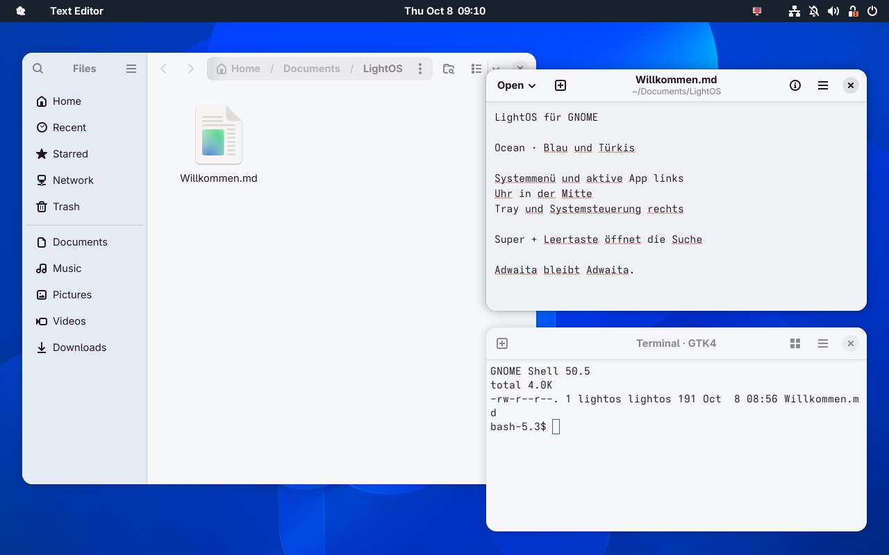
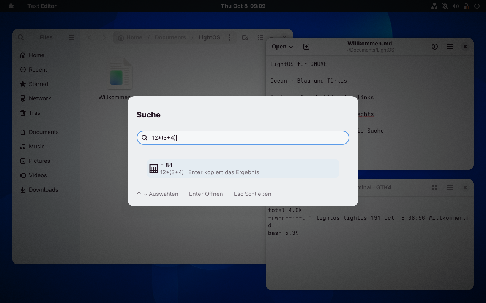

# LightOS für GNOME: VM-Prüfung

Geprüft am 8. Oktober 2026 in einer separaten **Fedora-44-VM, GNOME Shell 50.5, Wayland**, mit 1280 × 800 Pixeln. Alle Bilder sind Bildschirmaufnahmen dieser laufenden VM. Auf dem Live-System wurden keine Desktop-Einstellungen verändert und keine Erweiterung installiert.

Das VM-Overlay liegt unter `.cache/vm-gnome/`. Vor der GNOME-Einrichtung wurde der aktuelle LightOS-KDE-Projektstand darin installiert. Die bisherigen GTK-Anpassungen wurden im VM-Profil gesichert und native Adwaita-Einstellungen hergestellt. Das bestehende VM-Basisimage und `.cache/vm/` blieben erhalten.

## Desktop und Farbvarianten

Die Erweiterung übernimmt Systemmenü und aktive App links, Uhr mittig sowie Tray und GNOMEs Systemsteuerung rechts, ohne App-Icons und Lupe. GNOME stellt die Form der Menüs und Bedienelemente bereit. Der Standard ist Ocean mit Blau und Türkis.

| Palette | Helle Darstellung | Dunkle Darstellung |
|---|---|---|
| Ocean | [Screenshot](screenshots/gnome/ocean-light.png) | [Screenshot](screenshots/gnome/ocean-dark.png) |
| Grove | [Screenshot](screenshots/gnome/grove-light.png) | [Screenshot](screenshots/gnome/grove-dark.png) |
| Ember | [Screenshot](screenshots/gnome/ember-light.png) | [Screenshot](screenshots/gnome/ember-dark.png) |
| Iris | [Screenshot](screenshots/gnome/iris-light.png) | [Screenshot](screenshots/gnome/iris-dark.png) |
| T3 Chat | [Screenshot](screenshots/gnome/t3-chat-light.png) | [Screenshot](screenshots/gnome/t3-chat-dark.png) |
| T3 Code | [Screenshot](screenshots/gnome/t3-code-light.png) | [Screenshot](screenshots/gnome/t3-code-dark.png) |

Die Aufnahmen zeigen Dateien, GNOME Texteditor und Ptyxis als nativem GTK4-Terminal. Die Farbdefinitionen verwenden die vollständigen Hell-/Dunkelpaletten von [t3code](https://github.com/pingdotgg/t3code/blob/e803242d936af3e052757d59ab32bc7c4fcc2390/packages/shared/src/themePalettes.ts), festgehalten auf Revision `e803242d936af3e052757d59ab32bc7c4fcc2390`.

## Menüs, Einstellungen und Suche

| Änderung bzw. Verhalten | Aufnahme |
|---|---|
| Systemmenü mit nativen GNOME-Aktionen | [Systemmenü](screenshots/gnome/system-menu.png) |
| Auswahl aller sechs Paletten | [Farbwahl](screenshots/gnome/palette-menu.png) |
| Fenster der aktiven App und Schließen | [App-Menü](screenshots/gnome/active-app-menu.png) |
| Native Systemsteuerung und Hell-/Dunkelschalter | [Quick Settings](screenshots/gnome/quick-settings.png) |
| Native mittige Uhr mit Kalender | [Kalender](screenshots/gnome/calendar.png) |
| StatusNotifier-/DBusMenu-Anbindung | [Tray-Menü einer echten D-Bus-Testanwendung](screenshots/gnome/tray-menu.png) |
| Native Adwaita-Erweiterungseinstellungen | [Einstellungen](screenshots/gnome/preferences.png) |
| „Suche“ mit ausgeblendeter leerer Buttonzeile und kompakterem Abstand | [Neuer Dialog](screenshots/gnome/search-v2.png), [Vergleich vorher](screenshots/gnome/search-before-v2.png) |
| Native GTK4-Terminaloberfläche und Farben | [Ptyxis im Desktop](screenshots/gnome/desktop.png) |
| Native Qt-Farbschemata, Editor- und Auswahlfarben | [KWrite mit Grove](screenshots/gnome/qt-kwrite-grove.png) |
| Electron-Oberfläche über Code-Farbwerte | [VS Code](screenshots/gnome/electron-vscode-ocean.png) |
| Private GTK4-Konfiguration im Flatpak | [Flathub Calculator](screenshots/gnome/flatpak-calculator-ocean.png) |
| Rechnen, Enter kopiert `84` | [Suchdialog](screenshots/gnome/search-calculator.png) |
| Dateien und offene Fenster suchen | [Dateisuche](screenshots/gnome/search-files.png) |
| GNOME-Einstellungsanbieter | [Suchtreffer](screenshots/gnome/search-settings.png), [gestarteter Einstellungsbereich](screenshots/gnome/settings-app.png) |
| Apps finden und starten | [App-Suche](screenshots/gnome/search-apps.png) |
| Deaktivieren und ursprüngliche Darstellung | [Vorher](screenshots/gnome/before.png), [wiederhergestellt](screenshots/gnome/restored.png) |

## Prüfergebnisse

**804 Prüfungen bestanden:** 456 bestehende GNOME-Prüfungen, 299 zusätzliche GTK4-Terminal-Prüfungen und 49 Prüfungen für Qt/Electron/Flatpak. Die bestehenden GNOME-Prüfungen decken ab: Rechnen einschließlich negativer Zahlen, Potenzen und ungültiger Eingaben; alle zwölf Farbdefinitionen; ausschließlich Farbregeln; native Adwaita-Syntaxbasis; begrenzte Palettenpfade; wiederholtes Anwenden ohne doppelte CSS-Blöcke; exakte Wiederherstellung einschließlich fehlender Dateien, ursprünglicher Zeilenenden und zwischenzeitlicher Benutzeränderungen; Wiederherstellung gespeicherter App-Einstellungen nach erneutem Erzeugen des Managers.

Die native GTK-/libadwaita-Geometrie wurde ohne Erweiterung und danach für jede der zwölf Varianten im jeweiligen Hell-/Dunkelmodus gemessen. Alle Messwerte stimmen mit der ursprünglichen Darstellung überein:

| Bedienelement des Prüfprogramms | Breite × Höhe | Padding oben/rechts/unten/links |
|---|---|---|
| HeaderBar | 482 × 46 | 0 / 0 / 0 / 0 |
| Button | 398 × 24 | 5 / 17 / 5 / 17 |
| Entry | 414 × 34 | 0 / 9 / 0 / 9 |
| Switch | 40 × 20 | 3 / 3 / 3 / 3 |

Die Erweiterung setzt keine Radius-, Padding-, Margin- oder Schriftgrößenregeln für GTK-Apps. Das GTK-Theme bleibt `Adwaita`, die Icons `Adwaita`, die Schrift `Adwaita Sans 11`. Die Messungen beziehen sich auf das Prüfprogramm und sind keine Vorgabe für die Größe anderer App-Fenster.

Zusätzlich im laufenden GNOME geprüft:

- Super + Leertaste über VM-Tastatureingaben, auch aus der GNOME-Übersicht; Pfeiltasten und Enter.
- Enter kopiert das Rechenergebnis in die echte Zwischenablage. Bei ausstehender Suche werden alte Treffer entfernt und lokale Ergebnisse vor Enter aktualisiert.
- GNOMEs Einstellungsanbieter öffnet den gefundenen Display-Einstellungsbereich.
- Ein Mausklick öffnet das echte Tray-Menü; dessen Aktion erreicht die D-Bus-Anwendung. Nach Beenden verschwindet ihr Panel-Icon.
- GNOMEs nativer Dunkelmodus-Schalter synchronisiert die Erweiterung. „System“ folgt der ursprünglichen Farbpräferenz.
- Ein Wechsel des Such-Shortcuts gibt die vorherige Tastaturlayout-Belegung sofort frei.
- Live-Deaktivierung entfernt Panel-Elemente, verwaltete GTK-CSS und die zwölf erzeugten Editor-Schemata und stellt ursprüngliche Interface-Werte sowie alle zwölf verwalteten App-Einstellungen wieder her. Erneutes Aktivieren funktioniert.
- Installation des ZIP und erneuter Sitzungsstart; JavaScript-Syntax und GSettings-Schema geprüft. Unabhängige Quellprüfung ohne verbleibende konkrete Blocker.

Die neuen Qt-Farbschemata berücksichtigen [KColorSchemeManagers eigene Auswahl unter GNOME](https://raw.githubusercontent.com/KDE/kcolorscheme/master/src/kcolorschememanager.cpp) und [KTextEditors native Farbauswahl](https://raw.githubusercontent.com/KDE/ktexteditor/master/src/utils/kateconfig.cpp). Die Code-Anbindung verwendet die [dokumentierten Theme-Farbwerte](https://code.visualstudio.com/api/references/theme-color).

Die strukturierten Messwerte und Interaktionsergebnisse stehen in [gnome-validation.json](gnome-validation.json). Testprogramme: [GTK4-Terminal](../tests/test_gnome_terminal.js), [Qt/Electron/Flatpak](../tests/test_gnome_extra.js), [GJS-Prüfungen](../tests/test_gnome.js), [GTK-Geometrie](../tests/gnome-geometry.py), [Tray-Testanwendung](../tests/gnome-tray-fixture.py). Die Testfreigabe für Shell-Eval wurde nach Abschluss im VM-Profil wieder deaktiviert; die Erweiterung selbst benötigt sie nicht.

## Umfang und Grenzen

Der freigegebene Shell-Versionsbereich ist GNOME 50. Andere GNOME-Versionen und physische Mehrmonitor-/Audio-/Bluetooth-Hardware wurden nicht validiert. GNOMEs native Komponenten übernehmen diese Funktionen weiterhin.

GTK 3, GTK 4 und libadwaita erhalten Farbregeln. GtkSourceView 5, Ptyxis und GNOME Terminal erhalten zusätzliche App-Farbschemata. KDE/Qt erhält native .colors-Schemata, Farbgruppen in kdeglobals und die Farbauswahl in vorhandenen KDE-App-Konfigurationen. KWrite/Kate erhält zusätzlich native Syntax-Farbthemen; vorhandenes Qt5ct/Qt6ct eine native Palette. VS Code/VSCodium/Code OSS/Insiders werden über reine workbench.colorCustomizations gefärbt, einschließlich vorhandener Benutzerprofile. Vorhandene private Flatpak-Konfigurationen erhalten GTK-Farben und gegebenenfalls Qt-/Code-Anbindungen. Die Erweiterung verändert keine Sandbox-Berechtigungen. Andere Electron-Apps, Webseiten und fest eingebaute Theme-Farben benötigen eigene Schnittstellen. GNOME Console 50 erhält Hell/Dunkel, aber wegen eines Fehlers in seiner Palettenverarbeitung keine eigene Terminalpalette. Tray-Icons über Icon-Namen werden unterstützt; ausschließlich als Pixmap gelieferte Icons erhalten ein Ersatzicon. Das App-Menü zeigt Fensteraktionen, da GNOME kein universelles globales GTK-App-Menü anbietet.

Das installierbare Paket und die Anleitung stehen unter [LightOS für GNOME](../README.md).
