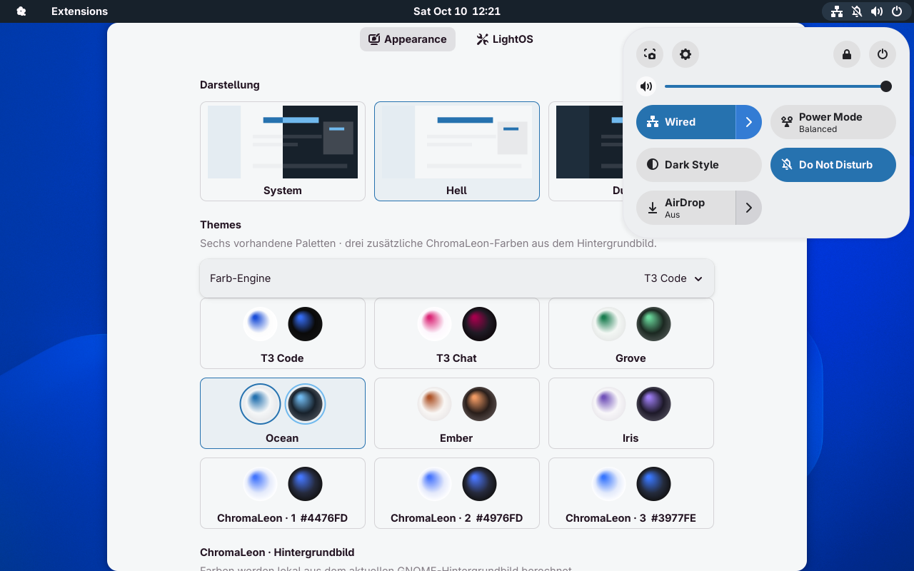

# LightOS

Eine umfangreiche, installierbare **GNOME-Shell-Erweiterung für GNOME 50 / Wayland**: Top Bar, Suche, sechs Farbpaletten in Hell und Dunkel und gemeinsame Farben für GNOME und weitere Apps. Standard ist Ocean mit Blau und Türkis. Entwickelt und geprüft in einer separaten Fedora-44-VM.



Die Top Bar übernimmt LightOS' Anordnung: Systemmenü und aktive Anwendung links, native GNOME-Uhr mittig, Tray und native Systemsteuerung rechts. Der kleine Orb ist ein symbolisches GNOME-Icon. GNOMEs Übersicht bleibt über Super und das Systemmenü erreichbar. Die rechte Seite enthält keine laufenden App-Icons und keine Lupe. Die Suche öffnet sich über Super + Leertaste.

Systemmenü, App-Menü, Kalender, Benachrichtigungen, Quick Settings und Einstellungen verwenden GNOMEs eigene Komponenten. Das App-Menü bietet Fensterwechsel und Schließen; GNOME bietet kein universelles globales GTK-Menü für alle GTK-Anwendungen. StatusNotifier-/DBusMenu-Anwendungen erhalten native GNOME-Menüs. Ein bereits vorhandener StatusNotifierWatcher wird mitbenutzt.

## Installation

Das Projekt enthält ausschließlich die GNOME-Erweiterung, ihre Tests und Entwicklungswerkzeuge. Es benötigt weder Plasma noch KWin. Das bisherige Plasma-Setup und der systemweite Desktop-Installer sind entfernt.

```bash
python3 tools/build.py
gnome-extensions install --force dist/lightos@lightos.dev.shell-extension.zip
```

Danach unter Wayland einmal ab- und anmelden, damit GNOME die neue Erweiterung erkennt:

```bash
gnome-extensions enable lightos@lightos.dev
gnome-extensions prefs lightos@lightos.dev
```

Die Erweiterungsinstallation benötigt kein sudo und richtet keine Dienste ein. Für die native GTK4-Terminaloberfläche wird **Ptyxis** verwendet, auf Fedora GNOME standardmäßig verfügbar. Falls es fehlt: `sudo dnf install ptyxis`, anschließend `ptyxis` starten. Die Erweiterung liefert und wählt dessen Farbpaletten; das bisherige GTK3-GNOME-Terminal bleibt ebenfalls unterstützt. Das ZIP enthält Layout, Suche, Farbpaletten und App-Anbindung. GNOME 49 und andere Shell-Versionen werden bisher nicht als kompatibel deklariert.

## Farben und Apps

Standard ist **Ocean, hell**: Blau `#2672af` und Türkis `#0a6f75`; dunkel `#70b9ee` und `#5bd0d6`. Weitere Paletten: Grove, Ember, Iris, T3 Chat und T3 Code. Alle sechs bieten Hell und Dunkel. „System“ stellt die ursprüngliche GNOME-Darstellung wieder her und folgt anschließend GNOMEs Farbpräferenz. Das Systemmenü bietet die Farbwahl, Quick Settings einen Hell-/Dunkel-Schalter.

Die vollständigen Farbdaten stammen aus [t3codes gemeinsamer Paletten-Datei](https://github.com/pingdotgg/t3code/blob/e803242d936af3e052757d59ab32bc7c4fcc2390/packages/shared/src/themePalettes.ts), Revision `e803242d936af3e052757d59ab32bc7c4fcc2390`. OKLCH-Farben wurden nach sRGB umgerechnet. Lizenz und Herkunft sind im ZIP enthalten.

| Anwendung | Anbindung |
|---|---|
| GTK 3 / GTK 4 / libadwaita | Farbvariablen in der benutzerspezifischen GTK-CSS; GTK 3 erhält zusätzlich ausschließlich Farbangaben für Fenster und Headerbars |
| Dateien, Einstellungen, Rechner, Erweiterungseinstellungen | Dieselbe GTK-/libadwaita-Palette |
| GNOME Texteditor / GtkSourceView 5 | Zwölf Farbschemata, native Adwaita-Syntaxbasis, automatische Auswahl im Texteditor |
| Ptyxis (GTK 4 / libadwaita) | Zwölf native Terminalpaletten einschließlich Titelzeile, Cursor und ANSI-Farben; Auswahl im vorhandenen Standardprofil |
| GNOME Terminal (GTK 3) | Farben des bestehenden Standardprofils, Cursor und Auswahl, passende native Hell-/Dunkeldarstellung |
| GNOME Console 50 | Hell-/Dunkelmodus; eigene Terminalpalette bleibt erhalten |
| KDE / Qt | Native `.colors`-Palette und Farbgruppen in `kdeglobals`; vorhandene KDE-App-Konfigurationen wählen sie explizit. Qt5ct/Qt6ct erhält eine native Farbpalette. Widget-Stil und Font bleiben erhalten |
| KWrite / Kate | Native Syntax-Themes aus dem vorhandenen Schema; nur Farben werden abgeleitet, Formatierung und Fonts bleiben erhalten |
| VS Code / VSCodium / Code OSS / Insiders | Oberfläche, Editor und Terminal über `workbench.colorCustomizations`, auch Benutzerprofile; vorhandenes Theme und andere Einstellungen bleiben erhalten |
| Flatpak-GTK-Apps | Farbregeln in vorhandenen privaten `.var/app/<App-ID>/config/gtk-{3,4}.0/gtk.css` ohne zusätzliche Sandbox-Rechte |
| Flatpak-KDE/Qt und Code | Entsprechende private App-Konfigurationen, wenn vorhanden bzw. für bekannte KDE/Qt-App-IDs |
| Andere GTK-Apps | Übernehmen die Palette, soweit sie die Systemfarben verwenden |

**Radien, Padding, Margins, Schriftgrößen, Icons und Fensterknöpfe der Apps werden nicht geändert.** GNOME behält seine Formen und Abstände. Neue Farben werden für GTK-Apps nach einem Neustart der jeweiligen App wirksam; einige Apps aktualisieren ihren Stil schon während des Wechsels.

Die Erweiterung nutzt jetzt die dokumentierten Farb-Schnittstellen von GTK, KDE/Qt und VS Code. Andere Electron-Apps und Webseiten brauchen eigene Farb-Schnittstellen; eine universelle Schnittstelle für alle privaten App-Themes gibt es nicht. Erst neu gestartete Apps werden automatisch auf neue Konfigurationsordner geprüft. GTK-/Qt-/Flatpak-Apps anschließend bei Bedarf neu öffnen. Flatpak-Berechtigungen werden nicht verändert. GNOME Console 50 verwirft eigene Paletten aufgrund eines [Fehlers im GVariant-Iterator](https://github.com/GNOME/console/blob/gnome-50/src/kgx-livery-manager.c#L307); Ptyxis ist die geprüfte GTK4-Alternative für vollständige Terminalfarben. Tray-Icons, die ausschließlich Pixmap-Daten liefern, erhalten derzeit ein Ersatzicon; Icons über Namen werden unterstützt.

## Suche statt KRunner

**Super + Leertaste** öffnet einen kompakten Suchdialog mit GNOMEs eigenen Komponenten:

- Apps starten und offene Fenster wechseln.
- Zuletzt verwendete lokale Dateien öffnen.
- GNOMEs aktivierte Suchanbieter verwenden, unter anderem Dateien, Einstellungen und Rechner.
- Arithmetik mit Klammern, Potenzen, Modulo und Dezimalzahlen berechnen; Enter kopiert das Ergebnis.
- HTTP-/HTTPS-Adressen im Standardbrowser öffnen.
- Pfeiltasten und Tab wählen, Enter aktiviert, Esc und Außenklick schließen.

Der Dialog heißt „Suche“. Eine unbenutzte Buttonzeile ist ausgeblendet; dadurch fällt der zusätzliche Abstand unter dem Bedienhinweis weg.

Die Suche verwendet keine Shell-Ausführung und kein JavaScript-`eval()` für Berechnungen. Externe Suchanbieter werden parallel aufgerufen, abgebrochene Suchläufe verworfen. Die Liste respektiert GNOMEs Suchanbieter- und Jugendschutzeinstellungen. Dateisuche außerhalb der zuletzt verwendeten Dateien benötigt einen aktivierten GNOME-Dateisuchanbieter und dessen Index.

[Search Light](https://github.com/icedman/search-light) und [Ulauncher](https://ulauncher.io/) wurden als Alternativen betrachtet. Die integrierte Suche benötigt keinen zweiten Launcher und wird mit demselben ZIP installiert.

## Wiederherstellung

```bash
gnome-extensions disable lightos@lightos.dev
```

Das entfernt die Panel-Elemente, stellt Aktivitäten und native Shell-Farben wieder her, entfernt verwaltete GTK-Farbblöcke und setzt verwaltete App-Einstellungen und Farbschemata zurück. Ursprüngliche Daten liegen bis dahin unter `~/.local/state/lightos-gnome/`. Qt-Farbeinstellungen und verwaltete Code-Farbwerte werden ebenfalls wiederhergestellt. Eigene CSS-Regeln bleiben erhalten, auch wenn sie während der Nutzung ergänzt wurden. Nachträglich abweichend geänderte App-Einstellungen werden nicht überschrieben. Die Sicherungen überstehen einen Shell-Neustart.

Super + Leertaste ist bei GNOME häufig mit dem Tastaturlayout-Wechsel belegt. Die Erweiterung sichert die kollidierende Belegung, lässt andere Layout-Shortcuts stehen und stellt die ursprüngliche Belegung beim Deaktivieren wieder her.

## VM-Prüfung und Aufnahmen

Siehe [Prüfbericht und alle Farbvarianten](gnome-validation.md). VM-Steuerung: `python3 tools/vm.py ssh|capture|key|click|install|start|stop`. Die VM nutzt SSH `127.0.0.1:2233`, VNC `127.0.0.1:5910` und QMP unter `.cache/vm-gnome/`. Die validierte VM verwendet eine bestehende QCOW2-Basis unter `.cache/`. Diese Basisdateien dürfen während des Betriebs nicht verändert oder gelöscht werden. Die Werkzeuge installieren und bedienen ausschließlich GNOME in der VM.

`tools/validate-vm.py` ist ein Testwerkzeug für diese VM. Es benötigt GNOMEs Eval-Funktion im VM-Entwicklermodus; sie wird für die finale Sitzung wieder deaktiviert. Die installierbare Erweiterung benötigt diesen Modus nicht.

## Projekt und Entwicklung


| Pfad | Inhalt |
|---|---|
| `extension/` | Installierbare GNOME-Erweiterung, Einstellungen, Paletten und optionale App-Farbadapter |
| `tools/` | ZIP-Build, VM-Steuerung, Tests und visuelle Validierung |
| `tests/` | Rechnen, Farbregeln, App-Anbindung, Wiederherstellung und GTK-Geometrie |
| `docs/` | Prüfberichte und echte GNOME-VM-Aufnahmen |
| `dist/` | Erzeugtes Extension-ZIP |

`python3 tools/test-vm.py` synchronisiert den GNOME-Projektstand und führt die isolierten GJS-Tests in der VM aus. Dabei werden temporäre XDG-Verzeichnisse und ein GSettings-Speicherbackend verwendet. [Architektur und Erweiterung der App-Anbindung](architecture.md), [Projektbereinigung](project-cleanup.md).

## Neue Optionen in LightOS 5

[Appearance und ChromaLeon](../README.md#appearance-und-chromaleon) ergänzt die
bisherigen Themes. [AirDrop](../README.md#airdrop) sitzt in den Quick Settings.
[Die bestehende Test-VM selbst bedienen](vm-access.md).
